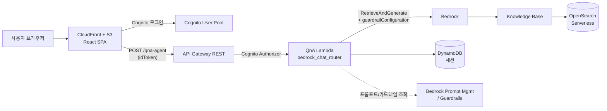

# CSC GenAI Lab — 지식 베이스 Q&A 챗봇

Amazon Bedrock **Knowledge Base RAG** 기반의 한국어 Q&A 챗봇 풀스택 애플리케이션입니다.
AWS PACE Generative AI Developer Workshop 스캐폴딩을 기반으로, 실제 운영 가능한 RAG 챗봇으로 확장했습니다.

- **RAG Q&A + 근거 문서(Citation)** — Bedrock `RetrieveAndGenerate`(HYBRID 검색)로 답하고, 답변 근거가 된 문서를 번호와 관련도 점수로 함께 표시합니다.
- **런타임 모델 선택** — 배포를 다시 하지 않고 챗봇 상단에서 응답 모델을 바꿉니다 (Claude Sonnet 4.6 / 4.5 / Haiku 4.5).
- **시스템 프롬프트 관리** — Bedrock Prompt Management에 저장한 프롬프트를 골라 답변 형식·말투를 바꿉니다.
- **가드레일** — Bedrock Guardrails로 유해 콘텐츠·거부 주제 차단, 개인정보(PII) 마스킹/차단을 챗봇에 적용합니다.
- **지식 베이스 문서 관리** — 웹에서 문서를 업로드하고 메타데이터·인제스트 상태를 관리합니다.

---

## 아키텍처

**모노레포 (pnpm workspace)**

| 패키지 | 내용 |
|---|---|
| `packages/cdk_infra` | AWS CDK 인프라(TypeScript) + Lambda 백엔드(Python) |
| `packages/reactjs_ui` | React SPA (Vite, Amplify/Cognito 인증) |

**CDK 스택** (`packages/cdk_infra/src/main.ts`)

| 스택 | 역할 |
|---|---|
| `CommonStack` | 공용 Lambda 레이어(boto3/powertools/pydantic), Cognito 사용자 풀, 접근 로그 버킷 |
| `BedrockKnowledgeBaseStack` | Bedrock Knowledge Base + OpenSearch Serverless 벡터 스토어 + S3 데이터소스 |
| `ChatbotStack` | 챗봇 백엔드 — `BedrockAgentsStack` + `BasicRestApiStack`(REST API·Lambda·DynamoDB 세션) |
| `WebsiteStack` | React SPA 호스팅(CloudFront + S3), `runtime-config.json`으로 백엔드 설정 주입 |

프론트는 빌드 시점 환경변수 없이, 배포 시 주입되는 `runtime-config.json`(apiUrl + Cognito ids)으로 동작합니다.

### 요청 흐름



챗봇 요청은 `modelId`·`promptTemplate`·`guardrailId`(모두 옵션)를 함께 받아, `RetrieveAndGenerate`의 모델 ARN·프롬프트 템플릿·가드레일(버전 `DRAFT`)로 런타임에 적용됩니다.

### 생성되는 AWS 리소스

`cdk deploy --all`로 배포 케이스(`deploy:case`)에 따라 아래 리소스가 생성됩니다.

| 스택 | 생성 리소스 |
|---|---|
| **CommonStack** | Cognito User Pool · User Pool Client · Identity Pool / Lambda Layer 3종(boto3·powertools·pydantic) / 접근 로그 S3 버킷 |
| **BedrockKnowledgeBaseStack** | Bedrock Knowledge Base / OpenSearch Serverless 컬렉션(벡터 스토어) / KB 데이터 S3 버킷 + 데이터소스 / KB 실행 IAM 역할 (임베딩: Titan Embed Text v2) |
| **ChatbotStack › AgentsStack** | Bedrock Agent + Alias / Agent 실행 IAM 역할 |
| **ChatbotStack › BasicRestApiStack** | API Gateway REST API / DynamoDB 세션 테이블 / Lambda 5종(QnA 챗·프롬프트·가드레일·KB 문서관리·대화요약) / Cognito Authorizer / Lambda IAM 역할(RAG·`ApplyGuardrail` 등) / 커스텀 리소스: 기본 프롬프트·가드레일 시드 |
| **WebsiteStack** | CloudFront 배포 / 웹 호스팅 S3 버킷(비공개, OAI) / `runtime-config.json` 주입(BucketDeployment) |

> **스택 밖 리소스:** 시드·웹 UI가 만드는 **Bedrock Prompt / Guardrail**은 CloudFormation 스택에 속하지 않는 독립 리소스라 `cdk destroy`로 삭제되지 않습니다. 정리는 `readme-test.md` / `.kiro/steering/ec2-ssm-cdk-destroy.md` 참고.

---

## 주요 기능 · 코드 위치

### 백엔드 (Python Lambda, `packages/cdk_infra/src/backend`)

| 기능 | REST 경로 | 위치 |
|---|---|---|
| RAG Q&A 챗봇 | `POST /qna-agent` | `basic_rest_api/lambda/qna_agent_rest_api` |
| 시스템 프롬프트 CRUD | `/prompts`, `/prompts/{id}` | `prompts/lambda/prompts.py` |
| 가드레일 CRUD | `/guardrails`, `/guardrails/{id}` | `guardrails/lambda/guardrails.py` |
| 지식 베이스 문서 관리 | `/kb/...` | `kb_management/lambda` |
| 대화 요약 | `/chat-summary` | `chat_summary/lambda` |

챗봇 요청 본문은 `message` + 런타임 옵션(`modelId`, `promptTemplate`, `guardrailId`)을 받습니다.
`bedrock_chat_router.py`가 이 값들로 `RetrieveAndGenerate`의 모델 ARN·프롬프트 템플릿·`guardrailConfiguration`(버전 `DRAFT`)을 조립합니다.

프롬프트·가드레일은 배포 시 커스텀 리소스로 기본값을 시드합니다(`prompt_seed.py`, `guardrail_seed.py` — 기본 답변 형식 프롬프트, 기본 전화번호 마스킹 가드레일).

### 프론트엔드 (React, `packages/reactjs_ui/src`)

| 화면 | 경로 | 위치 |
|---|---|---|
| Q&A 챗봇 (RAG) | `/bedrockagent` | `views/ChatView` |
| 시스템 프롬프트 | `/prompts` | `views/SystemPrompts` |
| 가드레일 | `/guardrails` | `views/Guardrails` |
| 문서 관리 | `/knowledgebase` | `views/DocumentManager` |

챗봇 헤더의 칩 드롭다운(`components/ChipDropdown`)에서 **모델 · 프롬프트 · 가드레일**을 골라 바로 적용합니다.

---

## 개발 환경

| 도구 | 버전 | 비고 |
|---|---|---|
| AWS CLI | Latest | |
| AWS CDK | Latest | |
| Docker | - | Lambda 레이어·에셋 번들링 (Rancher Desktop 대체 가능) |
| Node.js | ≥20.18.1 | |
| PNPM | 9.15.0 | 패키지 매니저 |
| Python | ≥3.12 | OpenAPI 스키마 생성 |

---

## 시작하기

```bash
pnpm install
```

### 로컬 프론트 개발

```bash
pnpm vite          # reactjs_ui 개발 서버 (백엔드 API는 runtime-config.json / VITE_API_URL 필요)
```

### 배포 (CDK)

배포 컨텍스트: `-c deploy:case=chatbot -c admin:email=<이메일> -c deploy:knowledgebase=true`

```bash
# 프론트 빌드 + 전체 스택 배포 (로컬에 Docker/부트스트랩 필요)
pnpm run cdk_infra:generate-openapi-schemas
pnpm run vite build
pnpm --filter cdk_infra cdk deploy --all --require-approval never \
  -c deploy:case=chatbot -c admin:email=<이메일> -c deploy:knowledgebase=true
```

> 실전 운영 환경(EC2 빌드 박스에서 SSM으로 빌드·배포/삭제)은 **[`readme-test.md`](./readme-test.md)** 플레이북을 따릅니다. 시나리오별(백엔드 Lambda만 교체 / 프론트 재배포 / 전체 클린 배포)과 가드레일 배포·삭제(`cdk destroy --all` + KB 데이터소스 선삭제) 절차가 정리돼 있습니다.

### 삭제

```bash
# KB 데이터소스는 RETAIN이라 destroy 전에 먼저 삭제해야 합니다 (readme-test.md §5 참고)
pnpm --filter cdk_infra cdk destroy --all --force \
  -c deploy:case=chatbot -c admin:email=<이메일> -c deploy:knowledgebase=true
```

---

## 참고 문서
- [`readme-test.md`](./readme-test.md) — 배포·수정·삭제 운영 플레이북 (EC2/SSM, 서울 리전 기준)
- `.kiro/steering/` — EC2·CDK 배포/삭제 상세 지침
