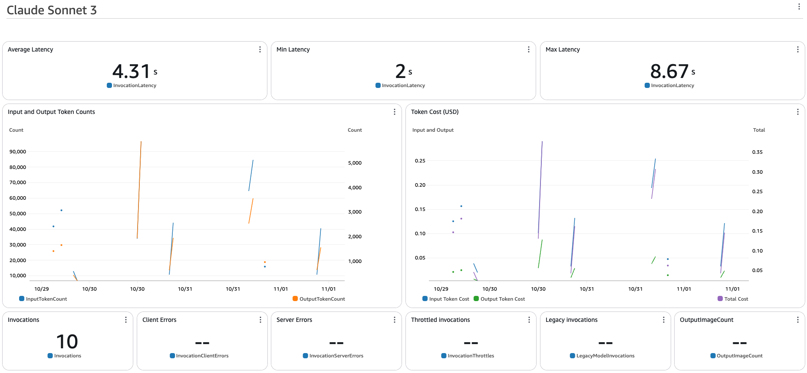

import { Steps } from '@astrojs/starlight/components';
import { Tabs, TabItem } from '@astrojs/starlight/components';
import { Card, CardGrid } from '@astrojs/starlight/components';

<CardGrid>
  <Card title="Chatbot Customization" icon="message">
    Customize prompts, knowledge base, and actions for the Chatbot implementation
  </Card>

  <Card title="CloudWatch Dashboard Customization" icon="chart">
    Set up and customize CloudWatch dashboards for performance tracking
  </Card>
</CardGrid>

## Chatbot Customization

### Customize Prompts

<Steps>
1. **Locate Prompt Files**
   - Navigate to `packages/cdk_infra/src/prompt/instruction/chatbot`

2. **Modify Instructions**
   - Open the prompt text file
   - Edit instructions as needed
   - Save your changes

3. **Deploy Changes**
   ```bash
   pnpm cdk_infra:deploy
   ```
</Steps>

#### Update Agent Alias (Optional)

:::tip
When you modify your agent's configuration, a new version is created. Use aliases to manage different versions without changing your code.
:::

For alias updates, see the [API Testing Guide](/guides/api-testing-guide#update-agent-alias).

### Configure Knowledge Base

:::note[Availability]
This section applies only if `"deploy:knowledgebase": true` is set in your configuration.
:::

<Steps>
1. **Access Knowledge Base**
   - Open [Amazon Bedrock Console](https://console.aws.amazon.com/bedrock)
   - Navigate to **Knowledge bases**
   - Select `KBBedrockAgenowledgeBase`

2. **Add Custom Data**
   - Click **Data Source** to access S3 bucket
   - Upload your documents
   - Return to Knowledge Base
   - Select **Amazon S3 Data source**
   - Click **Sync** for vector embedding generation

3. **Additional Options**
   - Configure alternative data sources (Web crawler, SharePoint)
   - Customize embedding settings
</Steps>

### Create Custom Actions

<Tabs>
  <TabItem label="Sample Actions">
    Two demonstration actions are provided:
    - `escalate`: Live agent escalation
    - `password_change`: Account password changes

    :::note
    These are demonstration actions without actual system changes.
    :::
  </TabItem>

  <TabItem label="Testing">
    <Steps>
    1. Open [Bedrock console](https://console.aws.amazon.com/bedrock)
    2. Navigate to **Agents**
    3. Select your agent
    4. Type: "I'd like to escalate"
    5. Test with email:
       - "test@thebigtest.com" for success
       - Any other email for failure
    </Steps>
  </TabItem>

  <TabItem label="Customization">
    <Steps>
    1. **Modify Actions**
       - Navigate to `cdk_infra/src/backend/agents/lambda/account_actions`
       - Update existing or add new actions
       - Ensure detailed descriptions for LLM understanding

    2. **Generate Schema**
       ```bash
       pnpm python:init-python-venv
       source ./.venv/bin/activate
       pnpm cdk_infra:generate-openapi-schemas
       ```

    3. **Deploy Changes**
       ```bash
       pnpm cdk_infra:deploy
       ```
    </Steps>
  </TabItem>
</Tabs>

## CloudWatch Dashboard Customization

Monitor your agent's performance and costs using the provided CloudWatch Dashboard.

<Steps>
1. **Access Dashboard**
   - Open CloudWatch Console
   - Navigate to Dashboards
   - Select your project dashboard

2. **View Metrics**
   

3. **Customize Configuration**
   - Navigate to relevant stack file:
     ```bash
     packages/cdk/infra/src/stacks/bedrock-agent-stack.ts
     ```
   - Update model ID and pricing
   - Deploy changes:
     ```bash
     pnpm cdk_infra:deploy
     ```
</Steps>

:::note[Cost Estimation]
Default dashboard shows Anthropic Sonnet model metrics. Estimates exclude costs for services like OpenSearch Serverless.
:::