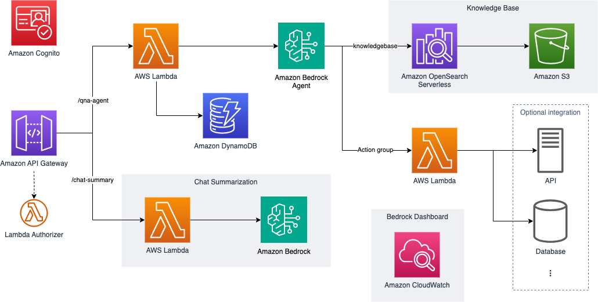

import { Card, CardGrid } from '@astrojs/starlight/components';
import { Steps } from '@astrojs/starlight/components';

## Available Deployment Options

This project deploys a single use case: an AI-powered chatbot with an Amazon Bedrock Agent, knowledge base, and action group integration. Use the `deploy:case` context value `chatbot` or `all` to deploy it — both values deploy the chatbot only.

<CardGrid stagger>
  <Card title="Chatbot" icon="seti:default">
    AI-powered chatbot with an Amazon Bedrock Agent with knowledge base and action group integration
    
    **Key Features**
    - Standard chatbot with an Amazon Bedrock Agent
    - Sample action groups powered by AWS Lambda (password change, escalation)
    - A Knowledge base backed by Amazon OpenSearch Serverless with metadata filtering
    - Amazon Cognito-authenticated UI
    - Chat summary capability
    
    [Learn more about the Chatbot](/intro/use-case-selection#chatbot)
  </Card>
</CardGrid>

## Service Integration Overview

- [Amazon Bedrock](https://aws.amazon.com/bedrock/)
- [Amazon OpenSearch Serverless](https://aws.amazon.com/opensearch-service/)
- [Amazon S3](https://aws.amazon.com/s3/)
- [Amazon API Gateway](https://aws.amazon.com/api-gateway/)
- [AWS Lambda](https://aws.amazon.com/lambda/)
- [Amazon DynamoDB](https://aws.amazon.com/dynamodb/)
- [Amazon CloudWatch](https://aws.amazon.com/cloudwatch/)
- [Amazon IAM](https://aws.amazon.com/iam/)
- [Amazon Cognito](https://aws.amazon.com/cognito/)

## Available Use Cases

### Chatbot
AI-powered chatbot with knowledge base and action group integration

#### Features
- Amazon Bedrock Agent with standard chatbot prompt
- Sample action group for the Agent: password change, escalation
- Knowledge base and metadata filtering with sample data
- Sample UI running on your local host with Cognito auth
- REST API to integrate with your own UI
   - QnA Agent API: Lambda backend to invoke Agent and store session information in DynamoDB table
   - Chat summary API (Optional): invoke Amazon Lite model to summarize the chat history for future use
   - Lambda custom authorizer as an example

## Next Steps

After choosing your use case:
<Steps>
1. Follow the [Deployment Guide](/intro/deployment) for step-by-step instructions.

2. Customize your solution using the [Customization Guide](/guides/customization-guide).

3. Test your deployment with the [Sample API Testing Guide](/guides/api-testing-guide).

4. When you're done, follow the [Cleanup Guide](/guides/cleanup-guide).
</Steps>

:::note
All deployments include basic infrastructure such as:
- Cognito authentication
- REST API endpoints
- DynamoDB session storage
- CloudWatch monitoring
:::