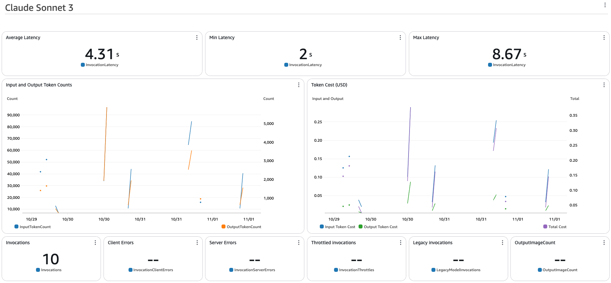

import { Steps } from '@astrojs/starlight/components';
import { Tabs, TabItem } from '@astrojs/starlight/components';
import { Card, CardGrid } from '@astrojs/starlight/components';

<CardGrid>
  <Card title="챗봇 커스터마이징" icon="message">
    챗봇 구현을 위한 프롬프트, 지식 베이스 및 액션 사용자 정의
  </Card>

  <Card title="CloudWatch 대시보드 커스터마이징" icon="chart">
    성능 추적을 위한 CloudWatch 대시보드 설정 및 사용자 정의
  </Card>
</CardGrid>

## 챗봇 커스터마이징

### 프롬프트 사용자 정의

<Steps>
1. **프롬프트 파일 찾기**
   - `packages/cdk_infra/src/prompt/instruction/chatbot`으로 이동

2. **지침 수정**
   - 프롬프트 텍스트 파일 열기
   - 필요에 따라 지침 편집
   - 변경 사항 저장

3. **변경 사항 배포**
   ```bash
   pnpm cdk_infra:deploy
   ```
</Steps>

#### Agent 별칭 업데이트(선택 사항)

:::tip
Agent 구성을 수정하면 새 버전이 생성됩니다. 코드를 변경하지 않고 다른 버전을 관리하려면 별칭을 사용하세요.
:::

별칭 업데이트는 [API 테스팅 가이드](/ko/guides/api-testing-guide#agent-별칭-관리)를 참조하세요.

### 지식 베이스 구성

:::note[가용성]
이 섹션은 구성에서 `"deploy:knowledgebase": true`로 설정한 경우에만 적용됩니다.
:::

<Steps>
1. **지식 베이스 접근**
   - [Amazon Bedrock 콘솔](https://console.aws.amazon.com/bedrock) 열기
   - **지식 베이스**로 이동
   - `KBBedrockAgenowledgeBase` 선택

2. **사용자 정의 데이터 추가**
   - **데이터 소스**를 클릭하여 S3 버킷에 접근
   - 문서 업로드
   - 지식 베이스로 돌아가기
   - **Amazon S3 데이터 소스** 선택
   - 벡터 임베딩 생성을 위해 **동기화** 클릭

3. **추가 옵션**
   - 대체 데이터 소스 구성(웹 크롤러, SharePoint)
   - 임베딩 설정 사용자 정의
</Steps>

### 사용자 정의 액션 생성

<Tabs>
  <TabItem label="샘플 액션">
    두 가지 데모 액션이 제공됩니다:
    - `escalate`: 실제 상담원 에스컬레이션
    - `password_change`: 계정 비밀번호 변경

    :::note
    이는 실제 시스템 변경 없이 시연하는 액션입니다.
    :::
  </TabItem>

  <TabItem label="테스팅">
    <Steps>
    1. [Bedrock 콘솔](https://console.aws.amazon.com/bedrock) 열기
    2. **Agents**로 이동
    3. Agent 선택
    4. "I'd like to escalate" 입력
    5. 이메일로 테스트:
       - 성공을 위한 "test@thebigtest.com"
       - 실패를 위한 다른 이메일
    </Steps>
  </TabItem>

  <TabItem label="커스터마이징">
    <Steps>
    1. **액션 수정**
       - `cdk_infra/src/backend/agents/lambda/account_actions`로 이동
       - 기존 액션 업데이트 또는 새 액션 추가
       - LLM 이해를 위한 자세한 설명 제공

    2. **스키마 생성**
       ```bash
       pnpm python:init-python-venv
       source ./.venv/bin/activate
       pnpm cdk_infra:generate-openapi-schemas
       ```

    3. **변경 사항 배포**
       ```bash
       pnpm cdk_infra:deploy
       ```
    </Steps>
  </TabItem>
</Tabs>

## CloudWatch 대시보드 커스터마이징

제공된 CloudWatch 대시보드를 사용하여 Agent의 성능과 비용을 모니터링하세요.

<Steps>
1. **대시보드 접근**
   - CloudWatch 콘솔 열기
   - 대시보드로 이동
   - 프로젝트 대시보드 선택

2. **지표 보기**
   

3. **구성 사용자 정의**
   - 관련 스택 파일로 이동:
     ```bash
     packages/cdk/infra/src/stacks/bedrock-agent-stack.ts
     ```
   - 모델 ID 및 가격 업데이트
   - 변경 사항 배포:
     ```bash
     pnpm cdk_infra:deploy
     ```
</Steps>

:::note[비용 추정]
기본 대시보드는 Anthropic Sonnet 모델 지표를 표시합니다. 추정치는 OpenSearch Serverless와 같은 서비스 비용은 제외합니다.
::: 