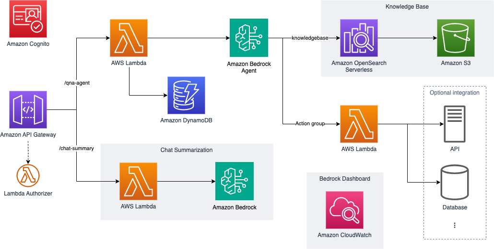

import { Card, CardGrid } from '@astrojs/starlight/components';
import { Steps } from '@astrojs/starlight/components';

## 사용 가능한 배포 옵션

이 프로젝트는 단일 사용 사례인 지식 베이스와 액션 그룹 통합이 포함된 Amazon Bedrock Agent 기반 AI 챗봇을 배포합니다. `deploy:case` 컨텍스트 값으로 `chatbot` 또는 `all`을 사용하세요 — 두 값 모두 챗봇만 배포합니다.

<CardGrid stagger>
  <Card title="챗봇" icon="seti:default">
    지식 베이스와 액션 그룹 통합이 포함된 Amazon Bedrock Agent 기반 AI 챗봇
    
    **주요 기능**
    - Amazon Bedrock Agent 기반 표준 챗봇
    - AWS Lambda 기반 샘플 액션 그룹 (비밀번호 변경, 에스컬레이션)
    - 메타데이터 필터링이 가능한 Amazon OpenSearch Serverless 기반 지식 베이스
    - Amazon Cognito 인증 UI
    - 채팅 요약 기능
    
    [챗봇에 대해 자세히 알아보기](/ko/intro/use-case-selection#챗봇)
  </Card>
</CardGrid>

## 서비스 통합 개요

- [Amazon Bedrock](https://aws.amazon.com/bedrock/)
- [Amazon OpenSearch Serverless](https://aws.amazon.com/opensearch-service/)
- [Amazon S3](https://aws.amazon.com/s3/)
- [Amazon API Gateway](https://aws.amazon.com/api-gateway/)
- [AWS Lambda](https://aws.amazon.com/lambda/)
- [Amazon DynamoDB](https://aws.amazon.com/dynamodb/)
- [Amazon CloudWatch](https://aws.amazon.com/cloudwatch/)
- [Amazon IAM](https://aws.amazon.com/iam/)
- [Amazon Cognito](https://aws.amazon.com/cognito/)

## 사용 가능한 사용 사례

### 챗봇
지식 베이스와 액션 그룹 통합이 포함된 AI 기반 챗봇

#### 기능
- 표준 챗봇 프롬프트가 포함된 Amazon Bedrock Agent
- 에이전트용 샘플 액션 그룹: 비밀번호 변경, 에스컬레이션
- 샘플 데이터가 포함된 지식 베이스 및 메타데이터 필터링
- Cognito 인증이 포함된 로컬 호스트에서 실행되는 샘플 UI
- 자체 UI와 통합할 수 있는 REST API
   - QnA 에이전트 API: 에이전트를 호출하고 DynamoDB 테이블에 세션 정보를 저장하는 Lambda 백엔드
   - 채팅 요약 API (선택사항): 향후 사용을 위해 Amazon Lite 모델을 호출하여 채팅 기록 요약
   - 예시로 제공되는 Lambda 커스텀 인증자

## 다음 단계

사용 사례를 선택한 후:
<Steps>
1. [배포 가이드](/ko/intro/deployment)에 따라 단계별 지침을 따르세요.

2. [사용자 정의 가이드](/ko/guides/customization-guide)를 사용하여 솔루션을 맞춤화하세요.

3. [샘플 API 테스트 가이드](/ko/guides/api-testing-guide)로 배포를 테스트하세요.

4. 완료 후 [정리 가이드](/ko/guides/cleanup-guide)를 따라 정리하세요.
</Steps>

:::note
모든 배포에는 다음과 같은 기본 인프라가 포함됩니다:
- Cognito 인증
- REST API 엔드포인트
- DynamoDB 세션 저장소
- CloudWatch 모니터링
::: 