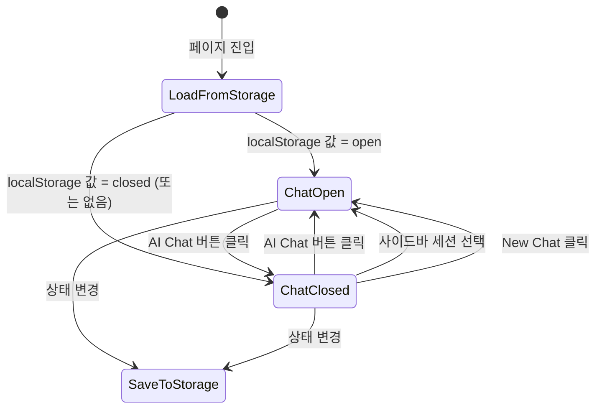
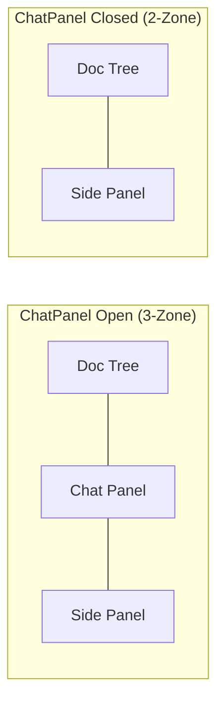
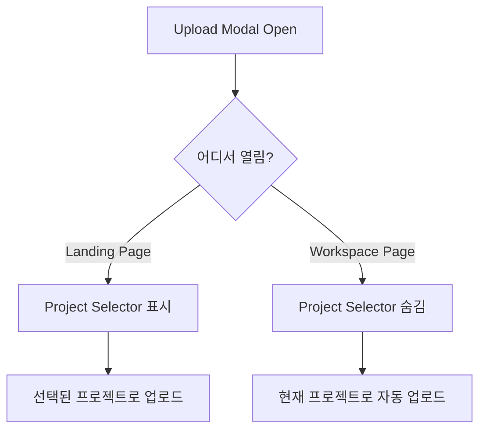

# Design Document: Workspace Chat Redesign

## Overview

이 설계는 워크스페이스 페이지의 채팅 패널을 토글 가능한 형태로 전환하고, 랜딩 페이지에서 문서 업로드를 주요 액션으로 제공하는 프론트엔드 UI 리디자인을 다룬다. 백엔드 변경 없이 순수 프론트엔드 작업으로 완료된다.

### 핵심 변경사항

1. **Chat Panel 토글**: 사이드바 "AI Chat" 버튼으로 채팅 패널 열기/닫기
2. **2-Zone / 3-Zone 레이아웃**: 채팅 닫힘 시 문서 트리 + SidePanel, 열림 시 문서 트리 + Chat + SidePanel
3. **랜딩 페이지 업로드**: DetailPanel에서 "문서 업로드" 주요 액션, "워크스페이스 열기" 보조 액션
4. **Upload Modal 프로젝트 선택기**: 랜딩 페이지에서 열릴 때 프로젝트 드롭다운 표시, 워크스페이스에서는 숨김

## Architecture

### 레이아웃 상태 흐름



### Workspace 레이아웃 구조



### Upload Modal 컨텍스트별 동작



## Components and Interfaces

### 1. 새로운 Hook: `useChatPanelVisibility`

```typescript
// hooks/useChatPanelVisibility.ts
interface UseChatPanelVisibilityReturn {
  isChatOpen: boolean;
  toggleChat: () => void;
  openChat: () => void;
  closeChat: () => void;
}

export function useChatPanelVisibility(): UseChatPanelVisibilityReturn;
```

**역할**: 채팅 패널의 열림/닫힘 상태를 localStorage와 동기화하여 관리한다.

- localStorage 키: `idp-chat-panel-open`
- 기본값: `false` (닫힘)
- 프로젝트 간 공유 (Requirement 6.3)

### 2. AppLayout 사이드바 변경

**파일**: `components/AppLayout/index.tsx`

변경사항:
- `navItems` 배열에 "AI Chat" 항목 추가 (단, 이 항목은 라우트 링크가 아닌 토글 버튼 역할)
- 워크스페이스 라우트(`/projects/$projectId`)가 활성 상태일 때만 활성화
- 비활성 라우트에서는 disabled 스타일 표시
- 활성 상태 스타일은 `isChatOpen` 값에 따라 적용

```typescript
// AI Chat 버튼은 Link가 아닌 button 요소로 렌더링
// pathname이 /projects/:projectId 패턴일 때만 활성화
interface AIChatNavButtonProps {
  collapsed: boolean;     // sidebar collapsed 상태
  active: boolean;        // chatPanel이 열린 상태인지
  disabled: boolean;      // workspace 라우트가 아닌 경우 true
  onClick: () => void;
}
```

**상태 공유 방식**: `useChatPanelVisibility` 훅을 AppLayout과 ProjectDetailPage 양쪽에서 호출. localStorage를 single source of truth로 사용하되, 동일 탭 내에서는 React state로 즉시 반영.

→ 문제: AppLayout과 ProjectDetailPage가 별도 컴포넌트 트리에 있지 않음. AppLayout이 children으로 라우트 컴포넌트를 렌더링하므로, 상태 공유를 위해 **ChatPanelContext**를 도입한다.

### 3. 새로운 Context: `ChatPanelContext`

```typescript
// contexts/ChatPanelContext.tsx
interface ChatPanelContextValue {
  isChatOpen: boolean;
  toggleChat: () => void;
  openChat: () => void;
  closeChat: () => void;
}

export const ChatPanelProvider: React.FC<{ children: ReactNode }>;
export function useChatPanel(): ChatPanelContextValue;
```

**위치**: AppLayout 내부 또는 App 최상위에서 Provider를 감싼다.

### 4. ProjectDetailPage 레이아웃 변경

**파일**: `routes/projects/$projectId.tsx`

변경사항:
- `useChatPanel()` 훅에서 `isChatOpen` 읽기
- `isChatOpen === false`일 때 ResizablePanelGroup에서 ChatPanel(id="chat") 패널을 제거
- 대신 SidePanel이 전체 가용 폭을 차지하는 단일 패널 구조로 전환
- ChatPanel의 WebSocket 세션은 유지 (마운트 유지 또는 상태 보존)

**중요 설계 결정**: ChatPanel 컴포넌트를 조건부 언마운트하지 않고 CSS `display: none`으로 숨기거나, 채팅 상태를 hook으로 분리하여 이미 보존 중이므로 조건부 렌더링이 가능. 현재 `useChatSession` 훅이 이미 상태를 관리하고 있으므로 **조건부 렌더링**이 가장 깔끔하다. 채팅 메시지는 `useChatSession`의 state에 보존되며, 패널을 다시 열면 동일 메시지가 표시된다.

### 5. SidebarSessionList 수정

**파일**: `components/AppLayout/SidebarSessionList.tsx`

변경사항:
- 세션 목록 항목 클릭 시 `openChat()` 호출하여 ChatPanel 자동 오픈
- "New Chat" 버튼 클릭 시 `openChat()` 호출
- 이를 위해 `useChatPanel()` 의존성 추가

### 6. DetailPanel 변경 (랜딩 페이지)

**파일**: `components/ProjectExplorer/index.tsx` 내부 `DetailPanel` 컴포넌트

변경사항:
- 기존 "워크스페이스 열기" 버튼을 보조(secondary) 스타일로 변경
- "문서 업로드" 버튼을 주요(primary) 스타일로 추가
- Upload 성공 시 문서 수 카운트 즉시 갱신

```typescript
interface DetailPanelProps {
  project: Project;
  docs: Document[];
  artifacts: Artifact[];
  onOpen: () => void;       // 워크스페이스 열기 (보조)
  onUpload: () => void;     // 업로드 모달 열기 (주요) — 새로 추가
  onSettings: () => void;
}
```

### 7. DocumentUploadModal 변경

**파일**: `components/DocumentUploadModal.tsx`

변경사항:
- 새 prop `projectId?: string` — 워크스페이스에서 열릴 때 전달되면 selector 숨김
- 새 prop `projects?: Project[]` — 랜딩 페이지에서 프로젝트 목록 전달
- 새 prop `onProjectChange?: (projectId: string) => void` — 선택 프로젝트 변경 콜백
- 새 prop `defaultProjectId?: string` — 기본 선택 프로젝트 ID

```typescript
interface DocumentUploadModalProps {
  isOpen: boolean;
  uploading: boolean;
  projectLanguage?: string;
  projectDocumentPrompt?: string;
  onClose: () => void;
  onUpload: (files: File[], options: DocumentProcessingOptions) => Promise<void>;
  // 새로 추가
  showProjectSelector?: boolean;    // true면 프로젝트 드롭다운 표시
  projects?: Project[];             // 프로젝트 목록 (showProjectSelector=true일 때)
  selectedProjectId?: string;       // 현재 선택된 프로젝트 ID
  onProjectSelect?: (projectId: string) => void;  // 프로젝트 변경 시 콜백
  projectsLoading?: boolean;        // 프로젝트 목록 로딩 중
  projectsError?: string | null;    // 프로젝트 목록 로딩 에러
}
```

### 8. ProjectExplorer 통합 (랜딩 페이지 업로드 흐름)

**파일**: `components/ProjectExplorer/index.tsx`

변경사항:
- `DocumentUploadModal` 임포트 및 상태 추가
- `showUploadModal` state, `uploadProjectId` state
- `useDocuments` 훅과 유사한 업로드 로직 추가 (또는 `useDocuments`를 범용화)
- 업로드 성공 시 `docsByProject` state 갱신

## Data Models

### localStorage 키 목록

| 키 | 타입 | 기본값 | 설명 |
|---|---|---|---|
| `idp-chat-panel-open` | `"true" \| "false"` | `"false"` | 채팅 패널 열림/닫힘 |
| `idp-panel-sizes-v2` | `number[]` (JSON) | `[70, 30]` | 패널 크기 비율 |
| `idp-doctree-collapsed` | `"true" \| "false"` | `"false"` | 문서 트리 접힘 |
| `idp-sidebar-collapsed` | `"true" \| "false"` | `"false"` | 사이드바 접힘 |

### ChatPanelContext Value Shape

```typescript
{
  isChatOpen: boolean;       // 현재 열림 상태
  toggleChat: () => void;    // 토글
  openChat: () => void;      // 강제 열기 (세션 선택 시)
  closeChat: () => void;     // 강제 닫기
}
```

### Upload Modal에 전달되는 프로젝트 데이터

```typescript
interface ProjectSelectorItem {
  project_id: string;
  name: string;
  language?: string;
  document_prompt?: string;
}
```

## Error Handling

| 시나리오 | 처리 방식 |
|---|---|
| localStorage 접근 실패 | 기본값(채팅 닫힘) 사용, console.error 로깅 |
| 프로젝트 목록 API 실패 | Project Selector에 에러 메시지 표시, 업로드 버튼 disabled |
| 업로드 API 실패 | 기존 DocumentUploadModal의 에러 처리 로직 유지 (toast 알림) |
| WebSocket 연결 끊김 | 채팅 패널 열림 상태와 무관하게 기존 reconnect 로직 유지 |
| 잘못된 localStorage 값 | JSON.parse 실패 시 기본값 사용 |

## Testing Strategy

### PBT 적용 불가 사유

이 기능은 순수 UI 레이아웃 토글, localStorage 상태 관리, React 컴포넌트 조건부 렌더링으로 구성되어 있어 property-based testing에 적합하지 않다. 입력 공간이 작고(boolean 토글), 핵심 로직이 side-effect(DOM 렌더링, localStorage 쓰기)에 의존한다.

### 테스트 전략

**Unit Tests (Vitest + React Testing Library)**:
- `useChatPanelVisibility` 훅: 토글 동작, localStorage 읽기/쓰기, 기본값 처리
- `ChatPanelContext`: Provider에서 값 전파 확인
- `DocumentUploadModal`: `showProjectSelector=true/false` 조건부 렌더링
- `DetailPanel`: 주요/보조 버튼 렌더링 및 클릭 핸들러

**Integration Tests (Vitest + React Testing Library)**:
- ProjectDetailPage: 채팅 토글 시 3-zone ↔ 2-zone 레이아웃 전환
- AppLayout + ProjectDetailPage: 사이드바 AI Chat 버튼 클릭 → 채팅 패널 토글
- ProjectExplorer: "문서 업로드" 버튼 → 모달 오픈 → 프로젝트 선택기 표시

**Edge Cases**:
- localStorage가 비어 있을 때 기본 동작 (채팅 닫힘)
- 다른 라우트에서 AI Chat 버튼 disabled 상태 확인
- 패널 열림 상태에서 프로젝트 전환 시 채팅 상태 리셋 + 패널 열림 유지
- Upload Modal에서 프로젝트 목록 로딩 실패 시 에러 상태
