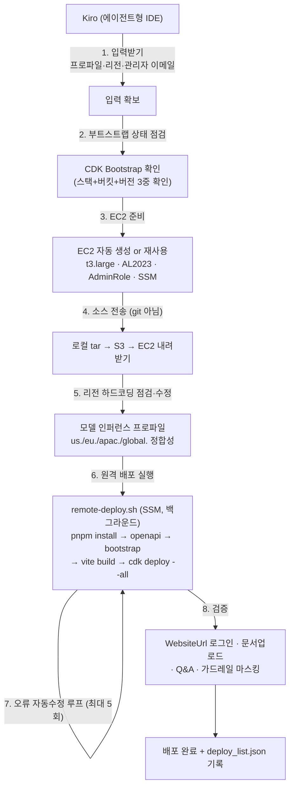
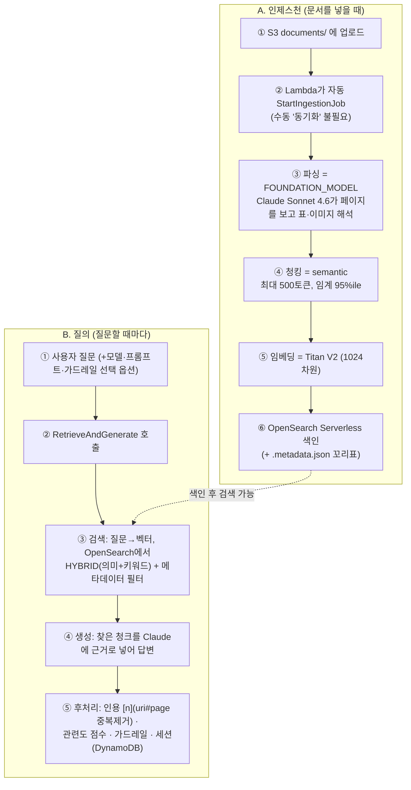

# Bedrock Knowledge Base (csc-genai-lab) — Kiro로 배포하고 이해하기

> AWS/Bedrock을 몰라도 이해할 수 있게 쓴 문서입니다.
> 주제: **Amazon Bedrock Knowledge Base**(관리형 RAG)를 **Kiro**로 배포하고, 그 **동작원리·아키텍처·청킹 전략**을 이해하기.
> 대상 프로젝트: `csc-genai-lab`(이 문서에서는 로컬 경로 `csc-genai-lab-main 2`). 끝에 직접 구축형 **IDP**(`megazone-idp`)를 짧게 비교합니다.

---

## 0. 30초 요약 (TL;DR)

**Bedrock Knowledge Base(KB)** = "문서를 올리면, 그 내용을 근거로 챗봇이 답하게 해주는" 것을 **AWS가 대부분 알아서 해주는 관리형 RAG 서비스**입니다. 개발자는 **파서·청킹·임베딩 모델만 고르면** 되고, 파싱→청킹→임베딩→벡터저장→검색은 AWS가 굴립니다.

이 프로젝트(`csc-genai-lab`)는 그 KB 위에 **챗봇 UI·가드레일·프롬프트 관리·인용·세션**을 얹은 풀스택 앱이고, **Kiro**(AWS의 에이전트형 IDE)가 **EC2/SSM으로 자동 배포**합니다.

| | 내용 |
|---|---|
| RAG 엔진 | Bedrock KB (관리형) — `RetrieveAndGenerate`(HYBRID 검색) |
| 파싱 | **FOUNDATION_MODEL** (Claude Sonnet 4.6가 페이지를 보고 표·이미지까지 해석) |
| 청킹 | **의미 기반(semantic)** — 최대 500토큰, 임계 95%ile |
| 임베딩 | Titan Embed Text V2 (1024차원) |
| 벡터 저장소 | OpenSearch Serverless |
| 배포 | **Kiro가 EC2/SSM으로 `cdk deploy --all` 자동 실행**(부트스트랩 드리프트·리전 하드코딩 자동 복구) |

**핵심: KB는 "무거운 검색 엔진을 AWS가 대신 만들어주고", 개발자는 "옵션 선택 + 앱 조립"만 한다. 그 배포마저 Kiro가 자동화한다.**

---

## 1. 먼저 — RAG가 뭔가 (그냥 AI에 붙여넣기와 뭐가 다른가)

가장 헷갈리는 부분부터.

**그냥 AI에 파일 붙여넣기** = 대화 한 번에 문서를 **통째로** 넣고 물어보기.
- 👍 간단. 👎 대화 끝나면 **사라짐**, 문서가 **수백~수천 개**면 한 번에 못 넣음.

**KB (RAG 방식)** = 문서를 미리 **잘게 쪼개 색인(index)해 저장**하고, 질문이 오면 **관련 조각만 꺼내** AI에게 준다.
- 👍 한 번 올리면 **영구 재사용**, 문서가 **수만 개**여도 관련 부분만 골라 씀, **출처(문서·페이지) 표시** 가능.

> 비유: 그냥 붙여넣기 = 매번 책 한 권을 통째로 읽어달라 부탁. RAG = **도서관에 색인을 만들어두고 질문에 맞는 페이지만 펼치는 것.**

**RAG의 4단계**: ① 파싱(글자·표 추출) → ② 청킹(조각내기) → ③ 임베딩(숫자 벡터화) → ④ 벡터 저장·검색. **Bedrock KB는 이 4단계를 통째로 대신** 해줍니다.

---

## 2. Bedrock Knowledge Base란?

**Amazon Bedrock Knowledge Base** = AWS의 **관리형 RAG 서비스**. "문서 올리면 검색 가능한 지식베이스로 만들어 주세요"를 **설정 몇 개**로 해줍니다.

AWS가 알아서 굴리는 부품:
- **데이터 소스**: S3(파일 보관함)에 문서를 올림
- **파싱(Parsing)**: 문서에서 글자·표를 뽑음 (`DEFAULT` / `FOUNDATION_MODEL` / `DATA_AUTOMATION` 중 택1)
- **청킹(Chunking)**: 텍스트를 조각으로 자름 (의미/고정/계층/없음 중 택1)
- **임베딩(Embedding)**: 각 조각을 숫자 벡터로 (Titan Embed Text V2, 1024차원)
- **벡터 저장소**: OpenSearch Serverless에 색인
- **검색+답변**: `RetrieveAndGenerate` API가 관련 조각을 찾아 Claude가 답 생성

→ **개발자가 하는 일 = 파서·청킹·임베딩 모델 "선택" + 그 주위에 인증·UI·가드레일·인용을 "조립".** 엔진 자체는 안 만듭니다.

---

## 3. Kiro로 배포하기 (이 문서의 핵심)

### 3-1. Kiro란?

**Kiro** = AWS의 **에이전트형 IDE**. 사람이 명령 한 줄씩 치는 대신, **스펙과 스킬을 읽고 스스로 여러 단계를 수행**합니다. 이 프로젝트에는 Kiro가 읽는 파일들이 들어 있습니다:

- **스펙**(`.kiro/specs/…`): 요구사항(requirements)·설계(design)·작업(tasks)을 문서로 정의 → Kiro가 이를 근거로 코드/작업 수행. (예: `genai-lab-ui-redesign`)
- **스킬**(`.kiro/skills/…/SKILL.md`): 반복 작업의 **플레이북**. 여기서 중요한 건 **`ec2-ssm-cdk-deploy`**(배포)와 **`ec2-ssm-cdk-destroy`**(삭제) 스킬.

즉 "이 프로젝트를 배포해줘"라고 하면, Kiro가 `ec2-ssm-cdk-deploy` 스킬을 **자동 활성화**해 아래 전 과정을 스스로 처리합니다.

### 3-2. 배포 방식 — "로컬이 아니라 EC2에서 CDK를 돌린다"

로컬 맥에서 바로 `cdk deploy`를 하지 않습니다. 이유: Lambda 번들링에 **Docker**가 필요하고, 리전·권한 환경을 깨끗하게 통제하기 위함. 그래서 **빌드 전용 EC2**에서 배포합니다.



**단계별 요점:**

**① 입력받기** — Kiro가 먼저 **AWS 프로파일 · 리전 · 관리자 이메일**(필수)을 묻습니다. 관리자 이메일로 Cognito admin 임시 비밀번호가 옵니다. 배포 컨텍스트는 `-c deploy:case=chatbot -c admin:email=<메일> -c deploy:knowledgebase=true`.

**② CDK Bootstrap 드리프트 점검** — 흔한 함정: **CDKToolkit 스택은 `CREATE_COMPLETE`인데, 실제 assets 버킷·IAM 역할은 계정 정리 등으로 삭제된 "drift" 상태.** 이때 "부트스트랩 됨"으로 오판하면 `needs bootstrapping` / `SSM parameter /cdk-bootstrap/... not found`로 배포가 깨집니다. 그래서 Kiro는 **① 스택 + ② assets 버킷 실존 + ③ 버전 파라미터**를 함께 확인하고, drift면 잔여 버킷을 비우고 재부트스트랩합니다.

**③ EC2 자동 생성/재사용** — 인스턴스 ID를 주면 재사용, 없으면 자동 생성:

| 항목 | 값 |
|---|---|
| 타입 | `t3.large` (2 vCPU, 8 GiB) |
| OS | Amazon Linux 2023 (SSM Parameter로 최신 AMI 조회) |
| IAM | `GenAILabDeployRole` (AdministratorAccess + SSM) |
| 네트워크 | 퍼블릭 IP + 아웃바운드(패키지·Docker pull), **SSM으로만 접속**(SSH 불필요) |
| VPC 모드 | `default`(기본)/`existing`/`new` — `new`는 겹치지 않는 `/16`을 자동 선택해 VPC+IGW+서브넷 생성 |

**④ 소스 전송(git clone 아님)** — 로컬 리포를 `tar`로 묶어(`node_modules`·`.git` 제외) **S3에 올리고 EC2에서 내려받음.** 사설 리포 키 설정이 불필요하고, **로컬의 최신 수정본이 그대로** 반영됩니다.

**⑤ 리전별 하드코딩 점검·수정** — 이 코드베이스엔 **리전 종속 하드코딩**이 있습니다(인퍼런스 프로파일 접두사 `us./eu./apac./global.`, EOL 모델, 고정이름 IAM 역할). Kiro는 배포 전에 `aws bedrock list-inference-profiles`로 **그 리전의 ACTIVE 모델**을 확인해 `cdk.json`의 `chat:defaultModelId`·`metadata:modelId`, Agent enum, UI 모델 목록을 맞춥니다.

**⑥ 원격 배포(`remote-deploy.sh`)** — SSM으로 EC2에서 백그라운드 실행 후 로그를 tail:
1. 도구 설치(Node 20, pnpm, Python 3.12, Docker, Git) → 2. `pnpm install` → 3. OpenAPI 스키마 생성 → 4. `cdk bootstrap`(멱등, 정상이면 skip) → 5. `vite build`(프론트) → 6. **`cdk deploy --all`** → 7. 스택 Outputs 기록.

**⑦ 오류 자동수정 루프(최대 5회)** — 로그에서 오류를 보고 **근본 원인 한 곳만** 고쳐 재배포. 자주 나오는 것: Docker 미기동, 리전에 모델 미활성, 청킹 API 버전 불일치(`ChunkingStrategy.SEMANTIC` 없음 등), 라이브러리 peer 충돌(→ synth 검증 후 최신화), 고정이름 KB/Agent 실행 역할의 **타 리전 충돌**.

**⑧ 검증** — WebsiteUrl 로그인 → 문서 업로드가 4단계(업로드→분석→메타데이터→벡터화) 완주 → Q&A 답변·인용 표시 → 가드레일(`default-phone-masking`)이 전화번호를 `{PHONE}`로 치환하는지 `apply-guardrail`로 확인. 모두 통과해야 "완료".

> Kiro는 생성한 모든 리소스(EC2·IAM·SG·VPC·S3·스택 목록·WebsiteUrl)를 **`deploy_list.json`에 기록**합니다. 나중에 `ec2-ssm-cdk-destroy` 스킬이 이 파일을 보고 정확히 되돌립니다.

### 3-3. 삭제(destroy) 시 주의
`cdk destroy --all` 전에 **KB 데이터소스를 먼저 지워야** 합니다(`dataDeletionPolicy: RETAIN`이라 자동 삭제 안 됨). 또 **시드된 Bedrock Prompt/Guardrail은 CloudFormation 스택 밖 독립 리소스**라 `cdk destroy`로 안 지워집니다 → 별도 정리. (Kiro의 destroy 스킬이 처리)

---

## 4. KB는 내부에서 어떻게 동작하나 (동작원리)

KB의 동작은 크게 **두 흐름**입니다.
- **A. 인제스천(색인)** — 문서를 *넣을 때* 한 번 일어나는 준비.
- **B. 질의(응답)** — 사용자가 *질문할 때마다* 일어나는 검색·답변.



### A. 인제스천 — 문서를 검색 가능하게
- **① 업로드 & ② 자동 인제스천**: 문서를 S3 `documents/`에 올리면 **Lambda가 `StartIngestionJob`을 자동 실행**(사람이 콘솔에서 "동기화" 누를 필요 없음). 이 프로젝트엔 인제스천 진입로가 **3가지**: (a) 배포 시 샘플 최초 동기화, (b) `documents/` 업로드 감지 자동 인제스트, (c) **웹 UI 파이프라인** — 업로드된 파일을 **Bedrock Converse(Claude Sonnet 4.6)로 요약 + 메타데이터를 자동 생성**해 `.metadata.json` 사이드카를 붙인 뒤 인제스트.
- **③ 파싱(FOUNDATION_MODEL)**: 이 프로젝트는 기본이 **비전 파싱**입니다 — Claude Sonnet 4.6이 페이지를 **보고** 표·이미지·레이아웃까지 해석. 추출된 이미지·표는 **별도 멀티모달 보관 버킷**에 저장해 인용에 활용.
- **④ 청킹(semantic)** → **⑤ 임베딩(Titan V2)** → **⑥ 저장(OpenSearch Serverless)**. 여기까지가 "한 번만" 하는 준비.

### B. 질의 — 질문에 답하기
- **`RetrieveAndGenerate`(type=KNOWLEDGE_BASE)** 한 번으로 검색+생성을 처리. 검색은 **`HYBRID`**(의미+키워드).
- **런타임 옵션**: 요청마다 **모델(`modelId`)·프롬프트 템플릿·가드레일(`guardrailId`)**을 바꿔 적용 → **재배포 없이** 챗봇 상단에서 전환.
- **인용**: `citations[].retrievedReferences`를 **`uri#page`로 중복 제거**해 번호를 매김. `<figure>` 같은 멀티모달 마크업은 스니펫에서 제거.
- **관련도 점수**: `RetrieveAndGenerate`는 점수를 안 주므로, **별도 `retrieve()`(numberOfResults 20, HYBRID)**로 청크별 점수를 따로 매김.
- **세션(멀티턴)**: RAG가 관리하는 `sessionId`를 **DynamoDB**에 저장해 다음 질문에서 대화가 이어짐.
- **리랭킹**: 이 프로젝트엔 미설정.

> ⚠️ 코드에 **Bedrock Agent**도 만들어져 KB가 붙어 있지만, **실제 채팅은 Agent를 거치지 않고 직접 `RetrieveAndGenerate`로** 처리합니다(그래야 런타임에 모델·프롬프트·가드레일 교체 가능). Agent는 스캐폴딩에 가깝습니다.

---

## 5. KB 아키텍처 — 어떤 스택으로 이루어지나

**모노레포(pnpm)**: `packages/cdk_infra`(CDK+Python Lambda) + `packages/reactjs_ui`(React SPA). CDK 스택은 **4개**:

| 스택 | 역할 | 생성 리소스(요약) |
|---|---|---|
| **CommonStack** | 공용 기반 | Cognito(User/Identity Pool), Lambda 레이어 3종(boto3·powertools·pydantic), 접근 로그 버킷 |
| **BedrockKnowledgeBaseStack** | **RAG 엔진** | Bedrock KB, **OpenSearch Serverless 컬렉션**, KB 데이터 S3(+데이터소스, RETAIN), 멀티모달 보관 버킷, KB 실행 IAM 역할, 임베딩 Titan V2 |
| **ChatbotStack** | 챗봇 백엔드 | ▸ **AgentsStack**(Bedrock Agent+Alias — 스캐폴딩) ▸ **BasicRestApiStack**(API Gateway REST + Lambda 5종[QnA·프롬프트·가드레일·KB문서관리·요약] + DynamoDB 세션 + Cognito Authorizer + 프롬프트/가드레일 시드) |
| **WebsiteStack** | 프론트 호스팅 | CloudFront + S3(비공개, OAI), 배포 시 `runtime-config.json`(API URL+Cognito ID) 주입 |

| 계층 | 관리 주체 |
|---|---|
| **KB 엔진(파싱·청킹·임베딩·검색)** | **Bedrock KB가 관리(블랙박스)** — 옵션만 선택 |
| 벡터·멀티모달 저장 | OpenSearch Serverless, S3 (관리형+설정) |
| 질의/응답 | `RetrieveAndGenerate` (관리형) |
| 거버넌스 | 가드레일·프롬프트 관리 (직접) |
| 대화/인증/UI | DynamoDB 세션, 인용 후처리, Cognito, React (직접) |

> **핵심 요약**: KB는 "문서→검색"의 무거운 엔진을 AWS가 통째로 대신 해주고, 개발자는 그 위에 **가드레일·인용·세션·프롬프트·인증·UI**를 얹습니다. "**엔진은 사고, 앱만 조립**"에 가깝습니다.

---

## 6. 청킹(Chunking) 전략 — 왜, 어떻게 자르나

**청킹 = 긴 문서를 검색하기 좋은 "조각(청크)"으로 자르는 것.** AI에게 관련 부분만 딱 집어 주려면 문서를 작은 단위로 저장해야 합니다.
- 너무 **크면**: 관련 없는 내용이 섞여 검색이 부정확. 너무 **작으면**: 문맥이 끊김.
- 그래서 "**얼마나·어떤 기준으로** 자르냐"가 검색 품질을 좌우 = 청킹 전략.

> 토큰(token) ≈ 단어 조각. 500토큰 ≈ 300~400단어(대략 한 문단~반 페이지).

### RAG의 대표 청킹 4가지 (일반 개념)

**① 고정 크기(Fixed-size)** — 의미와 무관하게 정해진 길이(예 500토큰)로 뚝뚝 자름, 보통 앞뒤를 조금 겹침(overlap). 👍 단순·빠름 👎 문장·표 중간에서 잘림.
**② 의미 기반(Semantic)** — 문장 의미가 비슷한 곳끼리 묶고 **화제가 바뀌는 지점**에서 자름. 👍 문맥이 잘 안 끊김 👎 계산이 무겁고 조각 크기가 들쭉날쭉.
**③ 계층 기반(Hierarchical)** — 큰 조각(부모)+작은 조각(자식)을 같이 만들어, **검색은 작은 조각으로 정밀하게, AI엔 부모(넓은 문맥)까지** 줌. 👍 정밀+문맥 둘 다 👎 복잡·저장량↑.
**④ 없음(None)** — 파일 하나를 통째로 한 조각. 문서가 짧거나 이미 잘게 나뉜 경우.

### 이 프로젝트의 실제 청킹 = **의미 기반(semantic)**
`packages/cdk_infra/src/stacks/bedrock-kb-stack.ts` + `cdk.json`:
```
chunking = semantic({ maxTokens: 500, bufferSize: 0, breakpointPercentileThreshold: 95 })
```
- **최대 500토큰**까지 한 조각, **화제 전환 임계 95%ile**(문장 간 의미 거리가 상위 5%로 크게 벌어지는 경계에서 자름), `bufferSize: 0`(경계 판단 시 인접 문장 버퍼 없음).
- Bedrock KB는 위 4가지를 **옵션으로 제공**하고 여기선 semantic을 골랐습니다.
- ⚠️ **청킹 방식은 처음 정하면 나중에 못 바꿉니다.** 바꾸려면 **데이터소스를 재생성 + 전체 재인제스트**가 필요합니다.

### 파싱 전략도 3택1
| 전략 | 방식 | 이 프로젝트 |
|---|---|---|
| `DEFAULT` | 기본 텍스트 추출 | |
| **`FOUNDATION_MODEL`** | **Claude가 페이지를 보고** 표·이미지 해석 | ✅ **기본값(Claude Sonnet 4.6)** |
| `DATA_AUTOMATION` | AWS BDA로 OCR·표·레이아웃 | |

즉 이 프로젝트는 처음부터 **비전 파싱**이 켜져 있어 스캔본·표·복잡한 레이아웃도 잘 읽습니다.

---

## 7. 메타데이터 · 가드레일 · 프롬프트 · 인용 (KB 주변 기능)

### 메타데이터 — 검색을 "조건 필터"로 보완
벡터 검색만으론 "**2023년 문서만**", "**bedrock 주제만**" 같은 딱 떨어지는 조건을 거르기 어렵습니다. KB는 파일 옆 **`.metadata.json` 사이드카**로 꼬리표를 붙입니다:
```json
{ "metadataAttributes": { "service": "bedrock", "topic": "quota", "year": 2023 } }
```
→ 검색 시 `vectorSearchConfiguration.filter`로 **"이 조건에 맞는 문서 안에서만"** 찾습니다. 이 프로젝트는 업로드 시 **Claude가 문서를 읽고 이 꼬리표를 자동 생성**하기도 합니다.

### 가드레일(Guardrails) — 유해·PII 차단 (KB 구성의 강점)
- **Bedrock Guardrails**로 유해 콘텐츠·거부 주제 차단, **개인정보(PII) 마스킹/차단**.
- 배포 시 커스텀 리소스가 기본 가드레일 **`default-phone-masking`**(전화번호 → `ANONYMIZE`)를 시드.
- 요청마다 `guardrailId`(옵션, 버전 `DRAFT`)를 `RetrieveAndGenerate`에 적용.

### 프롬프트 관리 & 인용 & 세션
- **Bedrock Prompt Management**에 저장한 프롬프트를 골라 답변 형식·말투 변경(재배포 불필요). 단, 기본 경로는 Bedrock 내장 프롬프트 유지(직접 덮으면 인용 스팬이 사라져서).
- **인용**: 답변 근거 문서를 번호+관련도 점수로 표시(`uri#page` 중복 제거).
- **세션**: DynamoDB에 대화 맥락 저장(멀티턴).

---

## 8. (짧게) IDP는 뭐가 다른가

같은 계열의 **직접 구축형**이 IDP(`megazone-idp`)입니다. KB가 "완제품"이면 IDP는 "직접 만든 공장"입니다. 요점만:

- **색인 대상이 다름**: KB는 **원문 텍스트 청크**를 그대로 임베딩. IDP는 각 페이지를 **이미지로 보고 비전 AI가 이해해서 새로 쓴 분석문+Q&A**를 임베딩("자르고 담기" vs "이해하고 담기").
- **청킹 개념이 없음**: IDP는 semantic/hierarchical을 고르는 게 아니라 **문서가 그림이면 페이지째, 글이면 길이째**로 자동 분할.
- **부가 기능**: 지식그래프(Neptune), 자동 분류·폴더 트리, 실시간 진행표시 등 — KB엔 없음.
- **규모/비용**: 약 14개 스택, 페이지마다 비전 LLM 호출이라 **무겁고 비쌈**. 대신 스캔본·도면·차트·인포그래픽에서 원문이 놓치는 내용까지 잡음.

| | **Bedrock KB (이 프로젝트)** | **IDP (megazone-idp)** |
|---|---|---|
| 성격 | AWS 관리형 완제품 | 직접 만든 파이프라인 |
| 문서 이해 | 텍스트 추출(FM 파서로 비전 보강) | 페이지를 **이미지로 보고 분석** |
| 색인 대상 | 원문 텍스트 청크 | AI가 쓴 분석문+Q&A |
| 청킹 | semantic(500토큰) 선택 | 페이지/길이 자동(전략 개념 없음) |
| 벡터 저장소 | OpenSearch Serverless | LanceDB(벡터+키워드+리랭크) |
| 지식그래프 | ✕ | Neptune |
| 만드는 비용 | 낮음 | 높음(14 스택) |
| 적합 | 표준 문서 Q&A를 빠르게 | 스캔본·도표·그래프·자동정리가 핵심일 때 |

> 한 줄 결론: **대부분의 "문서 올려 챗봇" 은 Bedrock KB로 충분**합니다(빠르고 싸고, FM 파서로 표·스캔본도 커버). **스캔·도면·차트나 지식그래프·자동분류가 제품의 핵심 가치일 때만** IDP 같은 커스텀이 값을 합니다.

---

## 부록 — 용어 빠른 사전
- **RAG**: 문서를 미리 색인해두고, 질문에 맞는 조각을 꺼내 AI가 답하게 하는 방식.
- **Bedrock Knowledge Base(KB)**: AWS의 관리형 RAG. 파싱·청킹·임베딩·벡터검색을 대신 해줌.
- **Kiro**: AWS의 에이전트형 IDE. 스펙(requirements/design/tasks)+스킬(SKILL.md)을 읽고 스스로 작업(여기선 EC2/SSM 자동 배포).
- **RetrieveAndGenerate**: KB에서 "검색+답변 생성"을 한 번에 하는 Bedrock API.
- **파싱(Parsing)**: 파일에서 글자·표를 뽑기. `FOUNDATION_MODEL`은 LLM이 페이지를 보고 해석.
- **청킹(Chunking)**: 문서를 검색용 조각으로 자르기(의미/고정/계층/없음).
- **임베딩(Embedding)**: 글을 의미가 담긴 숫자 벡터로 변환(Titan V2, 1024차원).
- **OpenSearch Serverless**: KB가 벡터를 저장·검색하는 관리형 벡터 저장소.
- **하이브리드 검색(HYBRID)**: 의미(벡터)+키워드 검색을 함께 씀.
- **메타데이터**: 내용이 아닌 꼬리표(종류·주제·연도). `.metadata.json` 사이드카로 필터링.
- **가드레일(Guardrails)**: 유해 콘텐츠·거부 주제 차단, PII 마스킹.
- **인용(Citation)**: 답변 근거 문서·페이지 표시.
- **세션**: 멀티턴 대화 맥락(DynamoDB 저장).
- **CDK Bootstrap 드리프트**: CDKToolkit 스택은 남았는데 assets 버킷/역할이 삭제된 상태 → 배포 실패 유발.
- **인퍼런스 프로파일**: 리전 그룹별 모델 라우팅(`us./eu./apac./global.`). 리전마다 가용 모델이 달라 하드코딩 주의.
- **BDA**: 표·양식·레이아웃 구조를 뽑는 AWS 문서 자동화(DATA_AUTOMATION 파서).

> ⚠️ 참고: 위 구성·값은 이 프로젝트(`csc-genai-lab`)의 실제 코드(`packages/cdk_infra`, `cdk.json`, `bedrock-kb-stack.ts`)를 개념 수준으로 정리한 것입니다. 모델 버전·리전 값은 바뀔 수 있으니 정확한 최신값은 코드를 기준으로 확인하세요.
